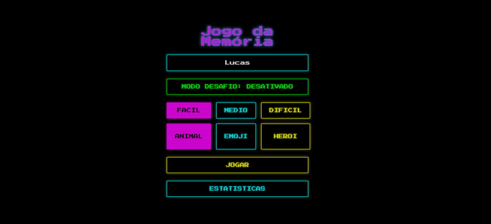
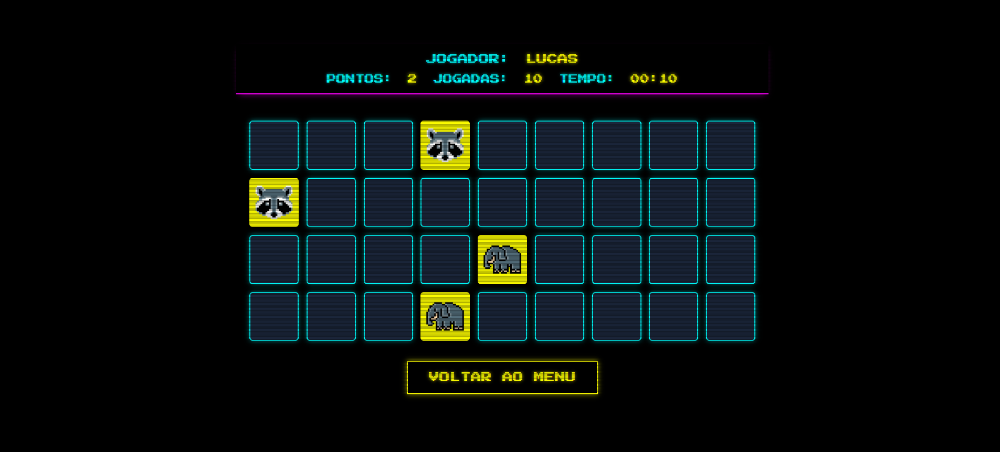
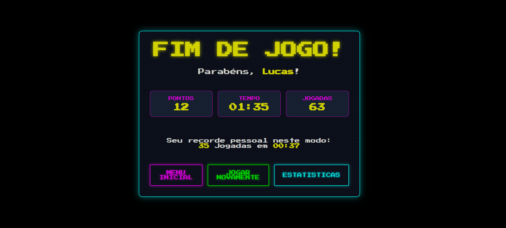
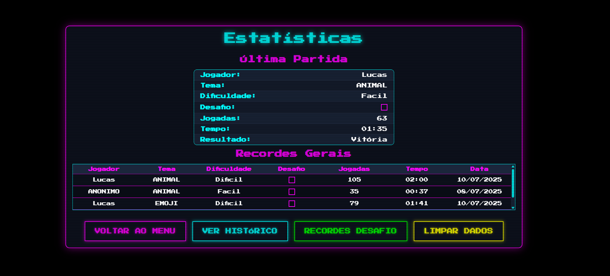

# 🕹️ Jogo da Memória - Estilo Retrô


Um Jogo da Memória clássico com uma temática de pixel art retrô, construído com React e Vite. Desafie sua mente com múltiplos temas, níveis de dificuldade e um modo desafio com limites de tempo e jogadas. Salve seus recordes e acompanhe seu progresso no histórico de partidas!

**✨ [Acesse a versão ao vivo e jogue agora!](https://lucasgontijo13.github.io/JogoDaMemoria/)**

---

### 📸 Galeria do Projeto

| Menu Principal e Opções | Gameplay e Animações |
| :---: | :---: |
|  |  |
| **Tela de Fim de Jogo** | **Estatísticas e Recordes** |
|  |  |

---

## 🎯 Sobre o Projeto

Este projeto foi desenvolvido como uma forma de aprimorar e demonstrar habilidades em React, focando na criação de um jogo completo e polido. A inspiração veio da nostalgia dos jogos de 8-bit, aplicando uma estética de pixel art em toda a interface. Além da lógica clássica do jogo da memória, foram implementadas funcionalidades avançadas para torná-lo mais desafiador e engajante, como um sistema de recordes, histórico de partidas e um modo "desafio" contra o relógio.

---

## ✨ Funcionalidades Principais

* **🎭 Múltiplos Temas:** Jogue com diferentes conjuntos de cartas, incluindo Animais, Emojis e Super-Heróis.
* **🧠 Níveis de Dificuldade:** Escolha entre os modos Fácil, Médio e Difícil, que alteram o tamanho do tabuleiro.
* **🏆 Sistema de Recordes:** O jogo salva seus melhores tempos e contagem de jogadas para cada combinação de tema e dificuldade.
* **⚔️ Modo Desafio:** Ative o modo desafio para jogar com limites de tempo e de jogadas, testando sua agilidade e precisão.
* **💾 Persistência de Dados:** Suas estatísticas, recordes e histórico de partidas são salvos no navegador usando `localStorage`, para que você nunca perca seu progresso.
* **📊 Tela de Estatísticas:** Visualize um resumo da sua última partida, seus recordes em ambos os modos de jogo e um histórico detalhado de todas as partidas jogadas.
* **🎉 Telas de Vitória e Derrota:** Interface clara e informativa ao final de cada partida, com opção de jogar novamente ou voltar ao menu.
* **🎨 Animações e Estilo Retrô:** Animações suaves de "flip" das cartas e um design geral inspirado em jogos clássicos, incluindo a fonte "Press Start 2P".

---

## 🛠️ Tecnologias Utilizadas

* **Frontend:** [React](https://react.dev/) (com uso extensivo de Hooks como `useState`, `useEffect` e `useCallback`)
* **Build Tool:** [Vite](https://vitejs.dev/)
* **Estilização:** CSS Puro com um design responsivo e animações (`keyframes`).
* **Hospedagem:** [GitHub Pages](https://pages.github.com/)

---

## 🚀 Como Executar o Projeto Localmente

Para rodar este projeto na sua máquina, siga os passos abaixo.

### Pré-requisitos
* [Node.js](https://nodejs.org/) (versão 18 ou superior)
* [Git](https://git-scm.com/)

### Instalação

1.  **Clone o repositório:**
    ```bash
    git clone [https://github.com/lucasgontijo13/JogoDaMemoria.git](https://github.com/lucasgontijo13/JogoDaMemoria.git)
    ```

2.  **Navegue até a pasta do projeto:**
    ```bash
    cd JogoDaMemoria
    ```

3.  **Instale as dependências:**
    ```bash
    npm install
    ```

4.  **Inicie o servidor de desenvolvimento:**
    ```bash
    npm run dev
    ```
    Agora, abra [http://localhost:5173](http://localhost:5173) no seu navegador para ver o projeto rodando.

---

## 🌐 Publicação (Deploy)

Este projeto está configurado para ser publicado facilmente no GitHub Pages.

1.  **Configure a base no `vite.config.js`:**
    A propriedade `base` já está configurada para este repositório.
    ```javascript
    // vite.config.js
    export default {
      // ...
      base: '/JogoDaMemoria/',
    }
    ```

2.  **Execute o script de deploy:**
    Este comando irá construir o projeto e enviá-lo para a branch `gh-pages`.
    ```bash
    npm run deploy
    ```

3.  **Ative o GitHub Pages:**
    Nas configurações do seu repositório, vá em "Settings" > "Pages" e configure a fonte de publicação para a branch `gh-pages`.

---

## 🎨 Créditos dos Ícones

Os ícones em pixel art utilizados neste projeto foram criados por diversos artistas talentosos e disponibilizados via [Flaticon](https://www.flaticon.com). Agradecimentos a: **j8chi, Freepik, Hamstring, YardenG, Miguel C Balandrano, frelayasia, e shmai.**

---

## 👨‍💻 Autores

**Lucas Gontijo**

* **GitHub:** [@lucasgontijo13](https://github.com/lucasgontijo13)
* **LinkedIn:** [Lucas Gontijo](https://www.linkedin.com/in/lucas-gontijo-693a90229/)

**Iasmin Garcia**

* **GitHub:** [@iasmimgarcia](https://github.com/iasmimgarcia)

---

## 📄 Licença

Este projeto está sob a licença MIT. Veja o arquivo [LICENSE](LICENSE) para mais detalhes.